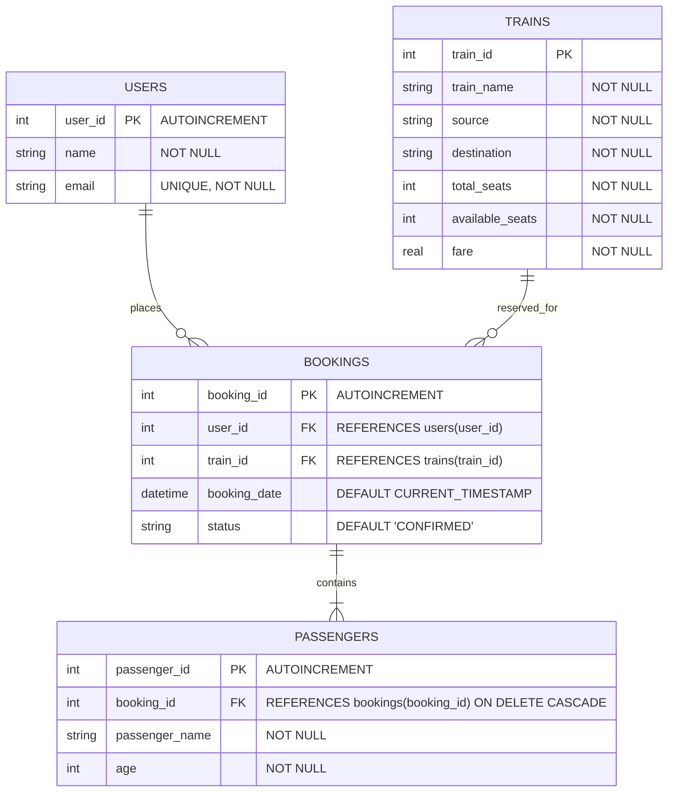

# Railway Ticket Reservation System

A comprehensive Database Management System (DBMS) mini project designed to demonstrate relational database architecture, real-time ticket reservations, seat inventory integrity, and operational analytics.

Built with **Python (Flask)**, **SQLite3**, and **Tailwind CSS**.

---

## 📌 Project Overview

Managing high-volume railway reservations requires strict transactional consistency, prevention of overbooking, and reliable relational integrity. 

This project provides an automated, query-driven interface to:
* **Live Route & Inventory Browsing**: View live train schedules, routes, and real-time seat availability.
* **ACID-Compliant Ticket Booking**: Reserve express tickets with automatic database-level seat validation and atomic seat deduction.
* **SQL View-Powered Booking History**: Inspect passenger ticket manifests using a 3-table relational `INNER JOIN` encapsulated in a database view.
* **Instant Cancellations**: Cancel bookings with automatic seat restoration managed by SQL triggers.
* **Analytical Dashboard**: Monitor train occupancy rates, active passenger counts, and total revenue powered by `LEFT OUTER JOIN` and `GROUP BY` aggregates.

---

## 🛠️ Technology Stack

* **Backend Framework:** Python 3, Flask
* **Database Management System:** SQLite3 (with Foreign Keys, Triggers, Views, and Indexes enabled)
* **Frontend:** HTML5, Jinja2 Templates, Tailwind CSS, FontAwesome Icons
* **WSGI Production Server:** Gunicorn

---

## 🗄️ Database Architecture & Relational Design

### Entity-Relationship (ER) Diagram



---

## 📊 Relational Tables Specification

1. **`users` Table**: Stores registered users/passengers initiating bookings.
   * `user_id` (INTEGER, Primary Key, Autoincrement)
   * `name` (TEXT, Not Null)
   * `email` (TEXT, Unique, Not Null)

2. **`trains` Table**: Maintains routes, fares, and real-time seat inventories.
   * `train_id` (INTEGER, Primary Key)
   * `train_name` (TEXT, Not Null)
   * `source` (TEXT, Not Null)
   * `destination` (TEXT, Not Null)
   * `total_seats` (INTEGER, Not Null)
   * `available_seats` (INTEGER, Not Null)
   * `fare` (REAL, Not Null)

3. **`bookings` Table**: Central transaction table recording ticket reservations.
   * `booking_id` (INTEGER, Primary Key, Autoincrement)
   * `user_id` (INTEGER, Foreign Key referencing `users(user_id)`)
   * `train_id` (INTEGER, Foreign Key referencing `trains(train_id)`)
   * `booking_date` (TEXT, Defaults to `CURRENT_TIMESTAMP`)
   * `status` (TEXT, Defaults to `'CONFIRMED'`)

4. **`passengers` Table**: Records passenger details attached to each ticket booking.
   * `passenger_id` (INTEGER, Primary Key, Autoincrement)
   * `booking_id` (INTEGER, Foreign Key referencing `bookings(booking_id)` with `ON DELETE CASCADE`)
   * `passenger_name` (TEXT, Not Null)
   * `age` (INTEGER, Not Null)

---

## ⚡ Key DBMS Principles Implemented

### 1. Referential Integrity & Foreign Keys
Enforced with `PRAGMA foreign_keys = ON;`. Child records in `bookings` and `passengers` cannot exist without valid parent records in `users` and `trains`.

### 2. Cascading Deletions (`ON DELETE CASCADE`)
Configured on `passengers.booking_id`. If a booking is deleted from the database, all associated passenger records are automatically pruned, preventing orphan records.

### 3. Database Indexes (`CREATE INDEX`)
Added to accelerate common query lookups and join operations:
* `idx_trains_route` on `trains(source, destination)`
* `idx_bookings_train` on `bookings(train_id)`
* `idx_passengers_booking` on `passengers(booking_id)`

### 4. Database Views (`CREATE VIEW`)
* **`v_booking_manifest` (3-Table Inner Join)**:
  Encapsulates a join between `bookings`, `trains`, and `passengers` to produce a unified ticket manifest without duplicating query logic in the application.
* **`v_train_occupancy_report` (Left Outer Join + Aggregation)**:
  Uses `LEFT JOIN` between `trains` and `bookings` along with `GROUP BY t.train_id` to aggregate confirmed passenger counts and compute occupancy percentage.

### 5. Automated SQL Triggers (`CREATE TRIGGER`)
* **`trg_check_seat_availability`**: A `BEFORE INSERT` trigger that calls `SELECT RAISE(ABORT, ...)` if a user attempts to book a train with zero available seats.
* **`trg_decrement_seat_on_booking`**: An `AFTER INSERT` trigger that automatically decrements `trains.available_seats` by 1 upon confirmation.
* **`trg_increment_seat_on_cancellation`**: An `AFTER UPDATE OF status` trigger that automatically replenishes `available_seats` when status changes from `CONFIRMED` to `CANCELLED`.

---

## 🔍 SQL Queries Showcase

### 3-Table `INNER JOIN` (View Definition)
```sql
CREATE VIEW v_booking_manifest AS
SELECT 
    b.booking_id,
    t.train_id,
    t.train_name,
    t.source,
    t.destination,
    t.fare,
    p.passenger_name,
    p.age,
    b.status,
    b.booking_date
FROM bookings b
JOIN trains t ON b.train_id = t.train_id
JOIN passengers p ON b.booking_id = p.booking_id;
```

### `LEFT OUTER JOIN` with `GROUP BY` and Conditional Aggregation
```sql
CREATE VIEW v_train_occupancy_report AS
SELECT 
    t.train_id,
    t.train_name,
    t.source,
    t.destination,
    t.total_seats,
    t.available_seats,
    (t.total_seats - t.available_seats) AS booked_seats,
    ROUND(((t.total_seats - t.available_seats) * 100.0 / t.total_seats), 1) AS occupancy_pct,
    COUNT(CASE WHEN b.status = 'CONFIRMED' THEN 1 END) AS confirmed_bookings,
    COALESCE(SUM(CASE WHEN b.status = 'CONFIRMED' THEN t.fare ELSE 0 END), 0) AS total_revenue
FROM trains t
LEFT JOIN bookings b ON t.train_id = b.train_id
GROUP BY t.train_id;
```

---

## 🚀 Getting Started (Run Locally)

### 1. Prerequisites
* Python 3.9 or higher
* Git

### 2. Clone the Repository
```bash
git clone https://github.com/helimehta2/dbms-mini-proj.git
cd dbms-mini-proj
```

### 3. Install Dependencies
```bash
pip install -r requirements.txt
```

### 4. Run the Application
```bash
python app.py
```
Open your browser and navigate to:
```text
http://127.0.0.1:5000/
```

---

## 🧪 Automated DBMS Edge Case Test Suite

To demonstrate and verify concurrency control, race conditions, and transactional integrity, run:
```bash
python test_edge_cases.py
```

This test suite verifies:
1. **Edge Case 1 (Concurrency & Overbooking Guard)**: Simulates two concurrent threads attempting to book the last remaining seat at the exact same millisecond. Verifies only 1 booking succeeds and 1 is rejected, leaving 0 seats (preventing race condition overbooking).
2. **Edge Case 2 (Double-Cancellation Idempotency)**: Verifies that multiple cancellation attempts on the same ticket are rejected, ensuring available seat inventory cannot be artificially inflated.
3. **Edge Case 3 (ACID Atomicity & Partial Crash Recovery)**: Simulates an error midway through a transaction (violating `CHECK` constraints), verifying that a complete `ROLLBACK` executes, leaving zero orphaned records.

---

## 🎯 Viva / Exam Preparation Q&A

**Q1: Where are JOINs used in your project?**  
*Answer:* We use an `INNER JOIN` connecting `bookings`, `trains`, and `passengers` in `v_booking_manifest` to display ticket manifests. We also use a `LEFT OUTER JOIN` between `trains` and `bookings` in `v_train_occupancy_report` so trains with zero bookings are still included in reports with 0 revenue.

**Q2: What is the purpose of database triggers in this system?**  
*Answer:* We implemented `AFTER INSERT` and `AFTER UPDATE` triggers to automatically decrement `available_seats` upon a new booking and increment it upon cancellation, ensuring business logic is enforced at the database layer rather than relying solely on application code.

**Q3: How is referential integrity enforced?**  
*Answer:* We enabled foreign keys using `PRAGMA foreign_keys = ON;`, with foreign keys linking `bookings` to `users` and `trains`, and `passengers` to `bookings` with `ON DELETE CASCADE`.

---

## 👩‍💻 Author
* **Heli Mehta** ([@helimehta2](https://github.com/helimehta2))
* Database Management System (DBMS) Mini Project
