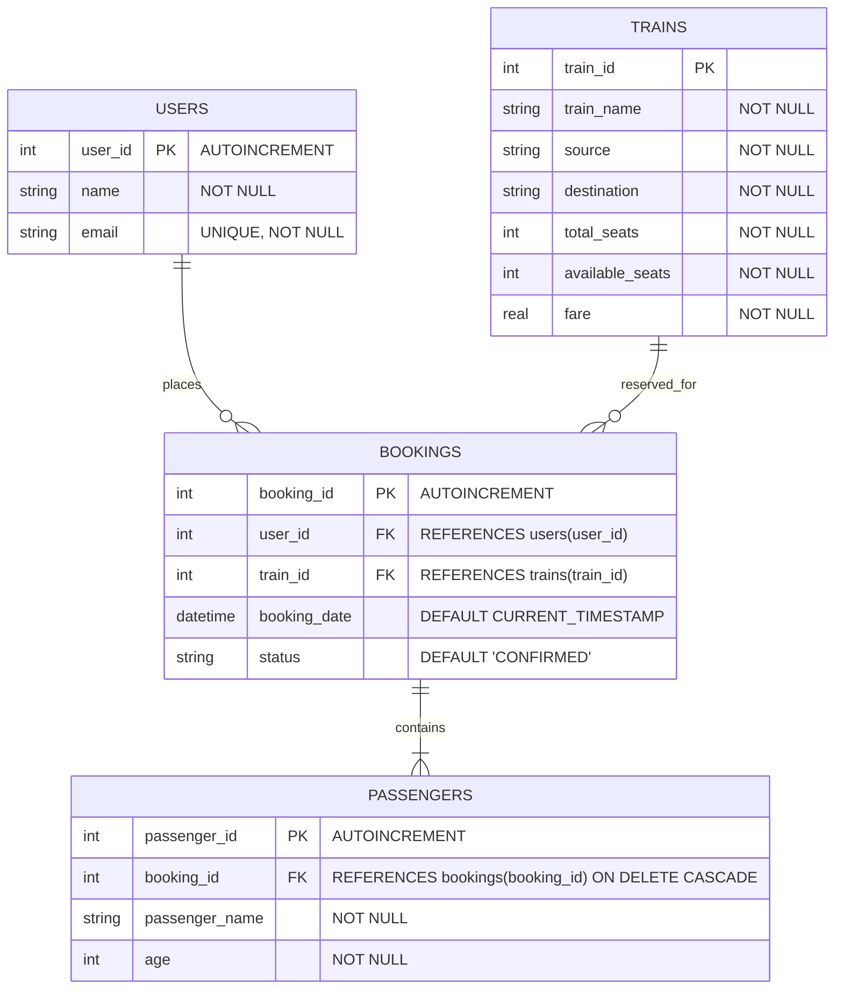

# Railway Ticket Reservation System

A full-stack Database Management System (DBMS) mini project designed to simulate a real-time railway ticket booking, seat inventory management, and cancellation platform.

Built with **Python (Flask)**, **SQLite**, and **Tailwind CSS**.

---

## 📌 Project Overview

Managing high-volume railway reservations requires strict transactional consistency, prevention of overbooking, and reliable relational integrity. 

This project provides an automated, query-driven interface to:
* View live train schedules and real-time seat availability.
* Book express tickets with atomic seat deduction and ACID transaction safety.
* View booking histories using relational multi-table `JOIN` queries.
* Cancel reservations with instant seat replenishment and status updates.

---

## 🛠️ Technology Stack

* **Backend:** Python 3, Flask
* **Database:** SQLite3 (with Foreign Key enforcement & Transaction rollback)
* **Frontend:** HTML5, Jinja2 Templates, Tailwind CSS, FontAwesome Icons
* **WSGI Production Server:** Gunicorn

---

## 🗄️ Database Design & Relational Schema

### Entity-Relationship (ER) Diagram



---

## 📊 Database Schema Details

### 1. `users` Table
Stores registered users/passengers initiating bookings.
* `user_id` (INTEGER, Primary Key, Autoincrement)
* `name` (TEXT, Not Null)
* `email` (TEXT, Unique, Not Null)

### 2. `trains` Table
Maintains routes, fares, and real-time seat inventories.
* `train_id` (INTEGER, Primary Key)
* `train_name` (TEXT, Not Null)
* `source` (TEXT, Not Null)
* `destination` (TEXT, Not Null)
* `total_seats` (INTEGER, Not Null)
* `available_seats` (INTEGER, Not Null)
* `fare` (REAL, Not Null)

### 3. `bookings` Table
Central transactional table recording ticket reservations.
* `booking_id` (INTEGER, Primary Key, Autoincrement)
* `user_id` (INTEGER, Foreign Key referencing `users(user_id)`)
* `train_id` (INTEGER, Foreign Key referencing `trains(train_id)`)
* `booking_date` (TEXT, Defaults to `CURRENT_TIMESTAMP`)
* `status` (TEXT, Defaults to `'CONFIRMED'`)

### 4. `passengers` Table
Records passenger details attached to each ticket booking.
* `passenger_id` (INTEGER, Primary Key, Autoincrement)
* `booking_id` (INTEGER, Foreign Key referencing `bookings(booking_id)` with `ON DELETE CASCADE`)
* `passenger_name` (TEXT, Not Null)
* `age` (INTEGER, Not Null)

---

## ⚡ Key DBMS Principles Implemented

1. **Referential Integrity**: Foreign key constraints are explicitly enforced using `PRAGMA foreign_keys = ON;`.
2. **Cascading Deletions**: If a booking is deleted, associated passenger records are automatically cascaded (`ON DELETE CASCADE`).
3. **Atomic Transactions (ACID Properties)**:
   * When reserving a seat, the system checks and decrements `available_seats`, creates a `booking`, and records `passengers` within a single atomic database transaction (`conn.commit()`).
   * If any step fails (e.g. no seats left), the transaction executes `conn.rollback()` to prevent inconsistent states.
4. **Relational Joins**: The bookings dashboard uses an inner `JOIN` query joining `bookings`, `trains`, and `passengers` to deliver complete ticket summaries without data duplication:
   ```sql
   SELECT b.booking_id, t.train_name, p.passenger_name, p.age, b.status, b.booking_date
   FROM bookings b
   JOIN trains t ON b.train_id = t.train_id
   JOIN passengers p ON b.booking_id = p.booking_id
   ORDER BY b.booking_id DESC;
   ```

---

## 🚀 Getting Started (Run Locally)

### 1. Prerequisites
* Python 3.9+ installed on your system
* Git installed

### 2. Clone the Repository
```bash
git clone https://github.com/helimehta2/dbms-mini-proj.git
cd dbms-mini-proj
```

### 3. Install Dependencies
```bash
pip install -r requirements.txt
```

### 4. Run the Application
```bash
python app.py
```

Open your browser and navigate to:
```
http://127.0.0.1:5000/
```

---

## 🌐 Deployment (Render / Cloud Platforms)

This project includes a `Procfile` ready for zero-configuration cloud deployment:
```
web: gunicorn app:app
```
* **Build Command:** `pip install -r requirements.txt`
* **Start Command:** `gunicorn app:app`

---

## 👩‍💻 Author
* **Heli Mehta** ([@helimehta2](https://github.com/helimehta2))
* Database Management System (DBMS) Mini Project
